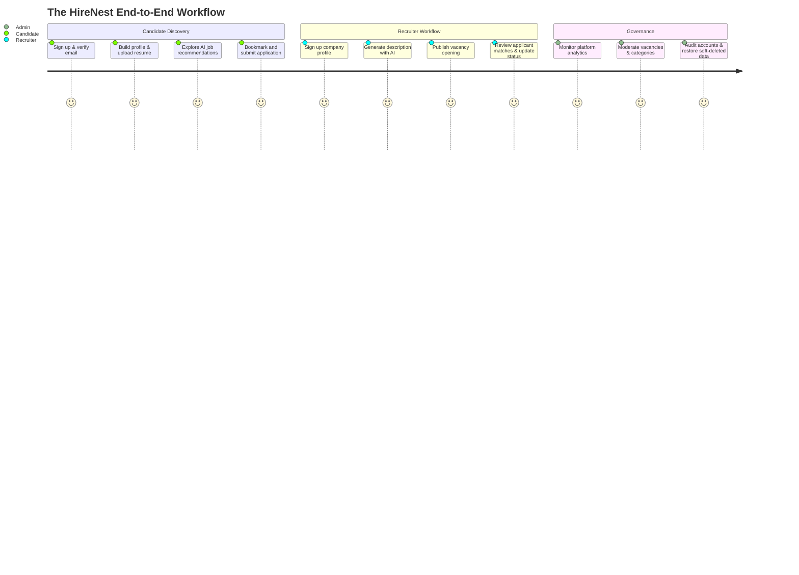
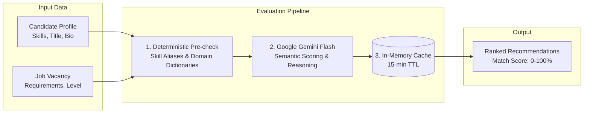
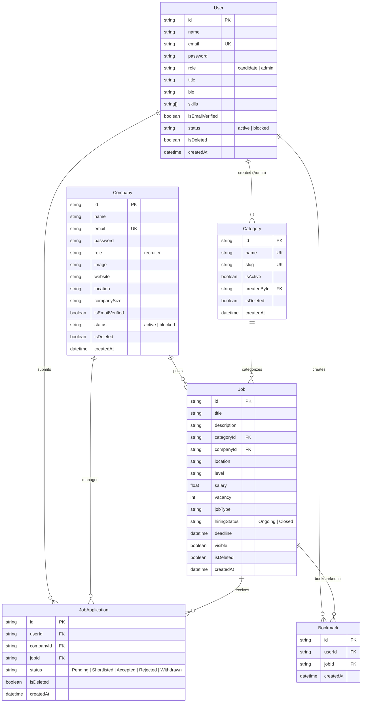
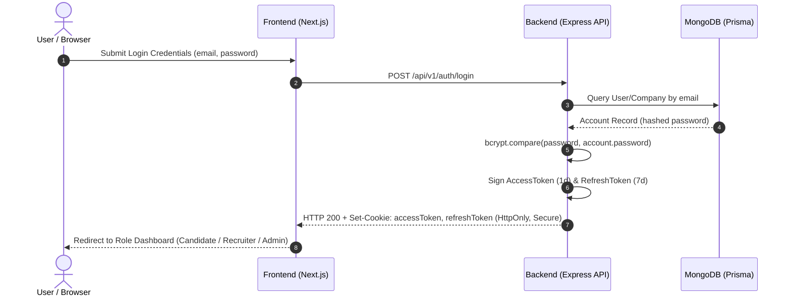
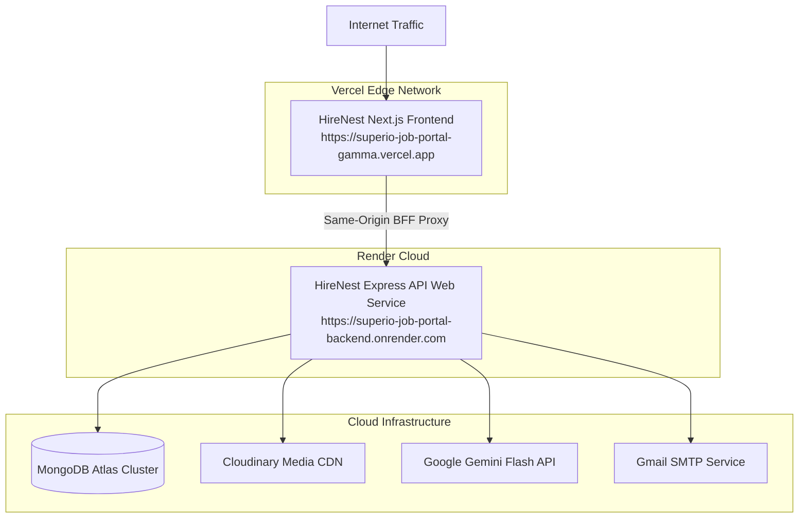

# HireNest

> **An AI-powered, role-based modern recruitment platform connecting talent with top employers through semantic candidate matching, automated job recommendations, and intelligent description generation.**

[](https://nextjs.org/)
[](https://react.dev/)
[](https://www.typescriptlang.org/)
[](https://expressjs.com/)
[](https://www.prisma.io/)
[](https://www.mongodb.com/)
[](https://tailwindcss.com/)
[](https://ai.google.dev/)

---

## 🌐 Live Deployments & Repository Links

- **Frontend Application:** [https://superio-job-portal-gamma.vercel.app](https://superio-job-portal-gamma.vercel.app)
- **Backend API Server:** [https://superio-job-portal-backend.onrender.com](https://superio-job-portal-backend.onrender.com)
- **API Base Endpoint:** `https://superio-job-portal-backend.onrender.com/api/v1`
- **Health Check Endpoint:** `https://superio-job-portal-backend.onrender.com/health`
- **GitHub Repository:** [https://github.com/rohanul-haque/superio-job-portal](https://github.com/rohanul-haque/superio-job-portal)

---

## 📑 Table of Contents

- [1. Project Overview](#1-project-overview)
- [2. Screenshots & UI Preview](#2-screenshots--ui-preview)
- [3. Key Features](#3-key-features)
  - [3.1 Public Features](#31-public-features)
  - [3.2 Candidate Features](#32-candidate-features)
  - [3.3 Recruiter Features](#33-recruiter-features)
  - [3.4 Admin Features](#34-admin-features)
- [4. AI-Powered Capabilities](#4-ai-powered-capabilities)
  - [4.1 AI Job Recommendations for Candidates](#41-ai-job-recommendations-for-candidates)
  - [4.2 AI Candidate Matching for Recruiters](#42-ai-candidate-matching-for-recruiters)
  - [4.3 AI Job Description Generator](#43-ai-job-description-generator)
  - [4.4 Gemini & LangChain Architecture](#44-gemini--langchain-architecture)
- [5. User Roles & Access Control (RBAC)](#5-user-roles--access-control-rbac)
- [6. Technology Stack](#6-technology-stack)
- [7. System Architecture](#7-system-architecture)
  - [7.1 High-Level Architecture Diagram](#71-high-level-architecture-diagram)
  - [7.2 Next.js BFF Proxy & Cookie Bridging](#72-nextjs-bff-proxy--cookie-bridging)
  - [7.3 Request Lifecycle](#73-request-lifecycle)
- [8. Project Directory Structure](#8-project-directory-structure)
- [9. Database Architecture & Schema](#9-database-architecture--schema)
  - [9.1 Entity Relationship Diagram (ERD)](#91-entity-relationship-diagram-erd)
  - [9.2 Prisma Models & Indexes](#92-prisma-models--indexes)
- [10. Authentication & Security Architecture](#10-authentication--security-architecture)
- [11. Complete REST API Reference](#11-complete-rest-api-reference)
- [12. Step-by-Step Local Development Setup](#12-step-by-step-local-development-setup)
  - [12.1 Prerequisites](#121-prerequisites)
  - [12.2 Clone the Repository](#122-clone-the-repository)
  - [12.3 MongoDB Configuration](#123-mongodb-configuration)
  - [12.4 Backend Installation & Setup](#124-backend-installation--setup)
  - [12.5 Frontend Installation & Setup](#125-frontend-installation--setup)
  - [12.6 First-Time Setup & Admin Seeder](#126-first-time-setup--admin-seeder)
  - [12.7 Running the Full Stack Locally](#127-running-the-full-stack-locally)
  - [12.8 Available NPM Scripts](#128-available-npm-scripts)
- [13. Environment Variables Guide](#13-environment-variables-guide)
  - [13.1 Frontend Environment Variables](#131-frontend-environment-variables)
  - [13.2 Backend Environment Variables](#132-backend-environment-variables)
- [14. Cloud Deployment Guide](#14-cloud-deployment-guide)
  - [14.1 Production Architecture Diagram](#141-production-architecture-diagram)
  - [14.2 MongoDB Atlas Configuration](#142-mongodb-atlas-configuration)
  - [14.3 Backend Deployment on Render](#143-backend-deployment-on-render)
  - [14.4 Frontend Deployment on Vercel](#144-frontend-deployment-on-vercel)
  - [14.5 Post-Deployment Verification](#145-post-deployment-verification)
- [15. Troubleshooting Guide](#15-troubleshooting-guide)
- [16. Development Guidelines](#16-development-guidelines)
- [17. Future Roadmap](#17-future-roadmap)
- [18. Contributing](#18-contributing)
- [19. License](#19-license)
- [20. Author & Contact](#20-author--contact)

---

## 1. Project Overview

**HireNest** is an enterprise-grade recruitment ecosystem engineered to bridge the gap between job seekers (**Candidates**) and hiring organizations (**Recruiters**), backed by operational governance tools for platform supervisors (**Admins**).

Traditional job boards suffer from keyword mismatching, candidate resume fatigue, and tedious manual posting workflows. HireNest addresses these bottlenecks by:

1. **Semantic Profile Matching:** Evaluating candidate qualifications, resumes, skills, and background using Google Gemini AI rather than naive keyword search.
2. **Generative Job Authoring:** Empowering recruiters to draft comprehensive, rich HTML job descriptions in seconds from basic parameters.
3. **Role-Based Experience:** Providing tailor-made dashboard workspaces for Candidates, Recruiters, and Administrators with strictly separated permissions.
4. **Resilient Architecture:** Combining Next.js 16 App Router on the frontend with Express v5 and Prisma ORM on MongoDB, unified by a same-origin Backend-For-Frontend (BFF) proxy to ensure seamless cross-domain HTTP-only cookie authentication.



---

## 2. Screenshots & UI Preview

> *Note: Static screenshots will be added to the repository in an upcoming release. Below is a structured walkthrough of the primary portal interfaces:*

### Public Portal
- **Landing Page (`/`):** Hero search banner, trending search keywords, featured categories carousel, recent vacancies, platform statistics, and testimonial carousel.
- **Find Jobs Directory (`/all-jobs`):** Debounced multi-filter catalogue with keyword search, category dropdowns, job type checkboxes, experience level filters, salary range inputs, and a 2-card desktop grid.
- **Job Details Page (`/apply-job/[id]`):** Detailed vacancy brief, salary tags, deadline indicator, direct Apply Now modal, and a dynamic **Similar Jobs** sidebar matching the viewed job's category.
- **Authentication Gateway (`/login`, `/register`, `/forgot-password`, `/reset-password`):** Unified role-aware sign-in, responsive registration tabs, secure password reset with eye toggle, and email verification screen.

### Candidate Experience
- **Overview Dashboard (`/candidate/dashboard`):** Total applications submitted, shortlisted counter, saved bookmarks, and recent application activity feed.
- **Candidate Profile Editor (`/candidate/dashboard/profile`):** Cloudinary avatar upload, verified resume PDF manager, technical skills tag editor, professional biography, and portfolio/social links.
- **Application History (`/candidate/dashboard/applied-jobs`):** Historical applications categorized by status (`Pending`, `Shortlisted`, `Accepted`, `Rejected`, `Withdrawn`) with instant withdrawal capability.
- **AI Job Recommendations (`/candidate/dashboard/recommendations`):** Gemini-powered job suggestions ranked by compatibility score with tailored reasoning.

### Recruiter Experience
- **Recruiter Dashboard (`/recruiter/dashboard`):** Live vacancy count, total applicants count, active applicant inflow charts powered by Recharts.
- **Post a Job (`/recruiter/dashboard/add-job`):** Form with title, category, type, level, salary, vacancy count, calendar deadline picker, and a **Generate Description with AI** button inserted directly into the rich Tiptap editor.
- **Job Manager (`/recruiter/dashboard/manage-jobs`):** Interactive table to toggle visibility (`visible: true/false`), close/reopen vacancies (`hiringStatus: Ongoing/Closed`), or edit/delete openings.
- **Applicant Tracking System (`/recruiter/dashboard/view-applicants`):** Filter applicants by job vacancy and status, review resume credentials in an interactive modal, and transition applicant statuses (`Shortlisted`, `Accepted`, `Rejected`).
- **AI Candidate Matching (`/recruiter/dashboard/recommendations`):** Select any active vacancy to instantly rank candidate profiles by AI suitability score without manual resume sifting.

### Administrative Console
- **Admin Dashboard (`/admin/dashboard`):** Real-time telemetry, user role distribution, and system-wide counters.
- **Moderation Suites (`/admin/dashboard/candidates`, `/admin/dashboard/recruiters`, `/admin/dashboard/jobs`):** Status toggling (`active` / `blocked`), soft-delete triggers, and candidate moderation.
- **Category Governance (`/admin/dashboard/categories`):** Add, update, toggle active status, and upload custom icons for job categories.
- **Trash Recovery (`/admin/dashboard/trash`):** Complete audit and restore portal for recovering soft-deleted users, companies, vacancies, and categories.

---

## 3. Key Features

### 3.1 Public Features
- **Global Search & Filter Engine:** Debounced keyword search, category filtering, employment type (`Full-time`, `Part-time`, `Remote`, `Contract`, `Internship`), experience level (`Beginner`, `Intermediate`, `Senior`), and salary range ($ USD).
- **Category-Based Similar Jobs:** Automatically discovers and displays similar job openings belonging to the same category on job detail views.
- **Enterprise Design System:** Fully compliant with HireNest's clean `#4F46E5` / `#6366F1` indigo palette and modern Outfit typography.
- **Responsive Layouts:** Mobile-optimized drawer navigation, collapsible filter panels, and responsive grids.

### 3.2 Candidate Features
- **Dedicated Candidate Authentication:** Independent candidate registration and sign-in with email format validation and rate-limited attempts.
- **Rich Profile Management:** Upload custom profile avatars and PDF resumes directly to Cloudinary storage.
- **Interactive Bookmarks:** Bookmark any job vacancy with synchronized state across cards, modals, and detail pages.
- **Application Tracking:** Track application status updates in real time with the ability to withdraw active submissions.
- **AI Recommendations:** View recommended jobs ranked by profile suitability with clear explanations for each recommendation.

### 3.3 Recruiter Features
- **Company Branding:** Manage corporate name, company logo, website URL, location, company size, bio, and social links.
- **AI Job Description Generator:** Generate detailed, realistic, rich HTML job descriptions in seconds using Google Gemini directly inside the job authoring form.
- **Full Vacancy Lifecycle:** Create, edit, toggle visibility on the marketplace, mark as Ongoing/Closed, or soft-delete vacancies.
- **Applicant Tracking (ATS):** Review candidate profiles, resumes, and portfolio links with one-click status transitions (`Shortlisted`, `Accepted`, `Rejected`).
- **AI Candidate Matching:** Score candidate compatibility against job vacancies using hybrid deterministic and semantic AI evaluation.

### 3.4 Admin Features
- **Isolated Admin Gateway:** Dedicated administrative authentication endpoint (`/admin/login`) isolated from public user login flows.
- **Account Moderation:** Block or unblock problematic candidate or recruiter accounts with instant session revocation.
- **Category Management:** Manage platform taxonomies, slugs, and Cloudinary icons.
- **Soft-Delete & Trash Recovery:** Restore mistakenly deleted vacancies, categories, or accounts through a centralized trash recovery console.
- **Automated Seeder:** Idempotent CLI script to bootstrap the initial Super Admin account securely.

---

## 4. AI-Powered Capabilities

HireNest integrates Google's **Gemini Flash** models orchestrated via **LangChain (`@langchain/google-genai`)** to deliver low-latency, deterministic-assisted semantic AI capabilities.



### 4.1 AI Job Recommendations for Candidates
- **Input:** Candidate's job title, biography, skills array, and resume profile.
- **Processing:** Normalized through 10 domain dictionaries (`Frontend`, `Backend`, `Mobile`, `DevOps`, `Data`, `AI/ML`, etc.) and evaluated against active vacancies using Gemini.
- **Output:** Returns ranked jobs with match percentages (0–100%), suitability tier (`High`, `Medium`, `Low`), matching rationale, and suggested missing skills.
- **Caching:** In-memory 15-minute TTL cache per candidate (`recommendationCache`) prevents redundant LLM invocations unless `?refresh=true` is requested.

### 4.2 AI Candidate Matching for Recruiters
- **Input:** Specific job vacancy requirements (level, title, description, skills).
- **Processing:** Performs deterministic skill intersection checks followed by LangChain structured output parsing via Gemini.
- **Output:** Ranks candidate applicants with match scores and highlight tags, eliminating manual resume filtering.
- **Caching:** Scoped by job ID (`candidateMatchingCache`) with 15-minute TTL.

### 4.3 AI Job Description Generator
- **Location:** Integrated directly in `Recruiter Dashboard → Post a Job`.
- **Form Inputs:** Collects Job Title, Category, Job Type, Experience Level, Salary, Location, and Open Vacancies.
- **Generation:** Instructs Gemini to craft structured HTML containing:
  - `<h3>Job Overview</h3>`
  - `<h3>Key Responsibilities</h3>` (bulleted `<ul><li>`)
  - `<h3>Required Qualifications</h3>`
  - `<h3>Technical & Professional Skills</h3>`
  - `<h3>Preferred Qualifications</h3>`
- **Safety & Sanitization:** Automatically strips markdown code fences, converts fallback markdown to HTML, and filters output through `sanitizeJobDescription()`.
- **UX Protections:** Prompts recruiter confirmation before overwriting existing text and leaves generated content fully editable inside `TiptapEditor`.

### 4.4 Gemini & LangChain Architecture
- **Model Configuration:** Configured to `gemini-flash-lite-latest` (or `gemini-flash-latest`) via `backend/src/config/index.ts`.
- **Singleton Keep-Alive:** Implemented via `backend/src/lib/gemini.ts` to reuse HTTPS connections.
- **Strict Key Isolation:** `GOOGLE_GEMINI_API_KEY` is strictly confined to the backend server and is never exposed to browser bundles.

---

## 5. User Roles & Access Control (RBAC)

HireNest enforces a strict three-tier Role-Based Access Control matrix across both frontend route guards and backend Express middlewares:

| Role | Database Model | Allowed Routes & Portals | Key Responsibilities & Capabilities |
|---|---|---|---|
| **CANDIDATE** | `User` (`role: "candidate"`) | `/candidate/dashboard/*`, `/all-jobs`, `/apply-job/*` | Search vacancies, save bookmarks, submit job applications, edit resume/profile, access AI recommendations. |
| **RECRUITER** | `Company` (`role: "recruiter"`) | `/recruiter/dashboard/*` | Create/edit vacancies, use AI job description generator, view applicant submissions, change candidate application statuses, view AI candidate matches. |
| **ADMIN** | `User` (`role: "admin"`) | `/admin/dashboard/*`, `/admin/profile` | Moderate users and companies, manage taxonomies/categories, monitor global metrics, restore soft-deleted entities from trash. |

### Access Enforcement Rules
- **Backend Middleware (`authGuard`):** Validates the caller's JWT access token, checks database existence, ensures the account is not blocked or soft-deleted, and verifies role membership. Unauthorized callers receive `401 Unauthorized` or `403 Forbidden`.
- **Frontend Middleware (`proxy.ts`):** Evaluates authentication cookies on protected dashboard paths (`/candidate/*`, `/recruiter/*`, `/admin/*`) and immediately redirects unauthorized visitors to role-appropriate login gates.

---

## 6. Technology Stack

### Frontend Architecture

| Category | Technology | Verified Version | Purpose & Usage |
|---|---|---|---|
| **Framework** | Next.js (App Router) | `^16.4.6` | React server components, static generation, dynamic API proxy route. |
| **Library** | React / React DOM | `^19.0.0` | Core UI library. |
| **Language** | TypeScript | `^5.6.3` | End-to-end static typing and interface definitions. |
| **Styling** | Tailwind CSS | `^4.0.6` | Utility-first responsive styling powered by `@tailwindcss/postcss`. |
| **Server State** | TanStack React Query | `^5.107.2` | Client caching, query deduplication, background revalidation. |
| **HTTP Client** | Axios | `^1.7.7` | Standardized API client with automatic 401 token refresh interceptors. |
| **Rich Text** | Tiptap | `^3.33.1` | Headless, extensible rich-text editor for job descriptions. |
| **Icons** | Lucide React | `^0.460.0` | Clean, modern iconography across all navigation and action items. |
| **Visualizations**| Recharts | `^3.10.1` | Interactive analytics charts in recruiter dashboard. |
| **Carousels** | Embla Carousel | `^8.6.0` | Smooth, touch-friendly homepage testimonial and category carousels. |

### Backend Architecture

| Category | Technology | Verified Version | Purpose & Usage |
|---|---|---|---|
| **Runtime** | Node.js / TSX | `Node >= 18`, `tsx ^4.19.2` | High-performance TypeScript execution environment. |
| **Framework** | Express.js | `^5.0.1` | Next-generation Express v5 REST API engine. |
| **ORM** | Prisma ORM | `^5.22.0` | Type-safe database queries, modeling, and client generation. |
| **Database** | MongoDB / MongoDB Atlas | `v6+` / Cloud Atlas | Document database configured with replica set connection strings. |
| **AI Engine** | LangChain / Google Gemini | `@langchain/google-genai ^2.3.6` | Structured generative AI for descriptions, recommendations, and matching. |
| **Validation** | Zod | `^3.23.8` | Strict runtime request body and query parameter validation schemas. |
| **Security** | bcryptjs / jsonwebtoken | `bcrypt ^2.4.3`, `jwt ^9.0.2` | Password hashing (salt rounds: 12) and dual JWT token authentication. |
| **Rate Limiter**| express-rate-limit | `^8.7.4` | Global (100 req/min) and strict route-specific brute-force limiters. |
| **Sanitization**| sanitize-html | `^2.18.2` | Strict HTML whitelist sanitization preventing XSS attacks. |
| **File Storage**| Multer / Cloudinary | `multer ^2.5.0`, `cloudinary ^2.11.0` | In-memory upload handling and persistent media hosting. |
| **Email** | Nodemailer | `^10.6.0` | HTML email dispatch via Gmail SMTP with fallback logger. |

---

## 7. System Architecture

### 7.1 High-Level Architecture Diagram

```mermaid
flowchart TD
    subgraph Client Tier
        BROWSER[Browser Client\nDesktop & Mobile]
    end

    subgraph Frontend Tier (Vercel)
        NEXT[Next.js 16 Application]
        ROUTER[App Router Pages\nPublic & Dashboards]
        BFF[Same-Origin BFF Proxy\n/api/backend/*]
        REACT_QUERY[TanStack Query Cache]
        
        NEXT --> ROUTER
        ROUTER --> REACT_QUERY
        REACT_QUERY --> BFF
    end

    subgraph Backend Tier (Render)
        EXPRESS[Express v5 REST API Server]
        GLOBAL_MW[Global Compression, CORS & Rate Limiter]
        ROUTE_MW[AuthGuard & Zod Validation Middleware]
        CONTROLLERS[Feature Controllers]
        SERVICES[Modular Application Services]
        
        EXPRESS --> GLOBAL_MW --> ROUTE_MW --> CONTROLLERS --> SERVICES
    end

    subgraph Data & Cloud Services Tier
        PRISMA[Prisma ORM Client]
        MONGO[(MongoDB Atlas Database)]
        GEMINI[Google Gemini 1.5/Flash AI]
        CLOUDINARY[Cloudinary CDN Storage]
        SMTP[Gmail SMTP Email Server]

        SERVICES --> PRISMA --> MONGO
        SERVICES --> GEMINI
        SERVICES --> CLOUDINARY
        SERVICES --> SMTP
    end

    BROWSER <--> NEXT
    BFF <-->|HTTP Requests with Cookies| EXPRESS
```

### 7.2 Next.js BFF Proxy & Cookie Bridging
To guarantee reliable cookie persistence across decoupled domains (e.g., `superio-job-portal-gamma.vercel.app` frontend and `superio-job-portal-backend.onrender.com` backend):
- Browser API requests target `/api/backend/*`.
- The Next.js server route handler (`frontend/src/app/api/backend/[...slug]/route.ts`) strips hop-by-hop headers and proxies requests directly to Express.
- Incoming `Set-Cookie` headers from Express are rewritten to match the frontend domain, binding `accessToken` and `refreshToken` safely as same-origin `HttpOnly` cookies.

### 7.3 Request Lifecycle
1. **User Action:** User submits a form or navigates to a protected dashboard.
2. **Client Dispatch:** Axios dispatches an HTTP request via the TanStack Query hook.
3. **BFF Proxying:** Browser dispatches to `/api/backend/...` which forwards cookies to the Express backend.
4. **Rate Limiting & CORS:** The backend validates CORS origins and checks global/route rate quotas.
5. **AuthGuard Verification:** Verifies the JWT token from cookies or `Authorization: Bearer` and verifies database account status.
6. **Zod Validation:** Validates payload schemas and rejects invalid data with HTTP 400.
7. **Service Execution:** Controller calls the business service to execute Prisma queries, Gemini calls, or Cloudinary uploads.
8. **Sanitized Response:** Express dispatches a standardized JSON response:
   ```json
   {
     "success": true,
     "statusCode": 200,
     "message": "Operation completed successfully",
     "data": { ... }
   }
   ```
9. **UI Synchronization:** TanStack Query updates its cache, re-renders the UI, and surfaces toast notifications.

---

## 8. Project Directory Structure

```text
superio-job-portal/
├── docs/
│   └── DESIGN_SYSTEM.md              # Frontend brand guidelines, palette, typography rules
│
├── frontend/                         # Next.js 16 Enterprise Frontend
│   ├── src/
│   │   ├── api/                      # Strongly-typed Axios HTTP endpoint calls
│   │   │   ├── admin.api.ts
│   │   │   ├── application.api.ts
│   │   │   ├── auth.api.ts
│   │   │   ├── bookmark.api.ts
│   │   │   ├── candidate.api.ts
│   │   │   ├── category.api.ts
│   │   │   ├── job.api.ts
│   │   │   └── recruiter.api.ts
│   │   ├── app/                      # Next.js App Router route hierarchy
│   │   │   ├── (public)/             # Public pages (Home, About, FAQ, Terms, All Jobs, Job Detail)
│   │   │   │   └── (auth)/           # Auth views (Login, Register, Forgot/Reset Password, Verify Email)
│   │   │   ├── admin/                # Admin portal (Login, Dashboard, Moderation, Trash)
│   │   │   ├── candidate/            # Candidate workspace (Dashboard, Profile, Applied, Bookmarks, AI Matches)
│   │   │   ├── recruiter/            # Recruiter workspace (Dashboard, Post Job, Manage Jobs, Applicants, Matches)
│   │   │   └── api/backend/          # Next.js BFF proxy route handler
│   │   ├── components/               # Modular UI component hierarchy
│   │   │   ├── admin/                # Admin moderation tables and modals
│   │   │   ├── auth/                 # ProtectedRoute guard and role wrappers
│   │   │   ├── candidate/            # Candidate cards, profile form, and stat widgets
│   │   │   ├── recruiter/            # JobForm, TiptapEditor, applicant review modals
│   │   │   ├── shared/               # Logo, navigation headers, footers, breadcrumbs
│   │   │   └── ui/                   # Reusable atomic elements (Button, Input, Card, Modal, Toast)
│   │   ├── context/                  # AuthContext, CandidateJobStateContext, QueryProvider
│   │   ├── hooks/                    # Reusable React Query custom hooks (use-candidate, use-recruiter, etc.)
│   │   ├── interfaces/               # Frontend TypeScript interface contracts
│   │   ├── lib/                      # Query keys, utility functions (`cn`), Tailwind helpers
│   │   ├── services/                 # Service layer wrapping API client and business logic
│   │   └── proxy.ts                  # Next.js edge route protection proxy
│   ├── .env.example                  # Frontend environment variables template
│   ├── next.config.ts                # Next.js configuration and remote image domains
│   ├── package.json                  # Frontend dependencies and npm scripts
│   ├── postcss.config.mjs            # PostCSS configuration for Tailwind v4
│   └── tsconfig.json                 # TypeScript compiler configuration
│
├── backend/                          # Express v5 TypeScript Enterprise Backend
│   ├── prisma/
│   │   └── schema.prisma             # MongoDB database schema and indexes
│   ├── src/
│   │   ├── config/
│   │   │   └── index.ts              # Centralized environment variable loader
│   │   ├── controllers/
│   │   │   └── health-check.controller.ts
│   │   ├── lib/
│   │   │   ├── cloudinary.ts         # Cloudinary SDK client configuration
│   │   │   ├── cors-options.ts       # CORS allowed origins and credentials rules
│   │   │   ├── gemini.ts             # Centralized Google Gemini / LangChain singleton
│   │   │   ├── jwt.ts                # Token signing, verification, and payload decoding
│   │   │   └── prisma.ts             # Global Prisma Client instance
│   │   ├── middlewares/
│   │   │   ├── authGuard.ts          # Role-based access control and token verifier
│   │   │   ├── authRateLimiter.ts    # Strict rate limiters for auth and AI endpoints
│   │   │   ├── globalErrorHandler.ts # Unified API error handler with Zod & Prisma mapping
│   │   │   ├── globalRateLimiter.ts  # General IP rate limiter (100 req/min)
│   │   │   ├── notFoundHandler.ts    # 404 resource handler
│   │   │   ├── upload.ts             # Multer memory storage and Cloudinary stream uploader
│   │   │   └── validateRequest.ts    # Zod schema validation middleware
│   │   ├── modules/                  # Feature-driven modular architecture
│   │   │   ├── admin/                # Admin moderation, trash, and seeder
│   │   │   ├── application/          # Job applications and status workflow
│   │   │   ├── auth/                 # Sign-in, registration, email verify, password reset
│   │   │   ├── bookmark/             # Job bookmarking and state management
│   │   │   ├── candidate/            # Candidate profile and stats
│   │   │   ├── category/             # Job taxonomies and icon uploads
│   │   │   ├── job/                  # Vacancy CRUD, AI description generator, similar jobs
│   │   │   ├── recommendation/       # Gemini AI candidate and job recommendation engines
│   │   │   └── recruiter/            # Recruiter company profiles and applicant management
│   │   ├── routes/                   # Central route aggregator and health check
│   │   ├── templates/                # Responsive HTML email templates (verify, reset password)
│   │   ├── utils/                    # AppError, catchAsync, sendResponse, sanitizeHtml, emailSender
│   │   ├── app.ts                    # Express application entry, middlewares, route mounts
│   │   └── server.ts                 # HTTP server bootstrap and graceful shutdown handlers
│   ├── .env.example                  # Backend environment variables template
│   ├── package.json                  # Backend dependencies and scripts
│   └── tsconfig.json                 # TypeScript compiler configuration
│
└── README.md                         # Primary project documentation
```

---

## 9. Database Architecture & Schema

The platform uses **MongoDB** managed through **Prisma ORM**. All IDs use native MongoDB `@db.ObjectId` mappings.

### 9.1 Entity Relationship Diagram (ERD)



### 9.2 Prisma Models & Indexes
- **Soft Deletes:** `User`, `Company`, `Category`, `Job`, and `JobApplication` include `isDeleted: Boolean` and `deletedAt: DateTime?` fields to preserve referential integrity and allow administrative restoration.
- **Compound Uniques:**
  - `JobApplication`: `@@unique([userId, jobId])` strictly prevents candidates from submitting duplicate applications for the same opening.
  - `Bookmark`: `@@unique([userId, jobId])` prevents duplicate bookmarks.
- **Performance Indexes:**
  - Jobs: Indexed on `[isDeleted, visible, hiringStatus, createdAt]`, `[companyId, isDeleted, createdAt]`, and `[categoryId, isDeleted, visible, hiringStatus]` for sub-millisecond catalogue filtering.
  - Users & Companies: Indexed on `[role, status, isDeleted]` for high-throughput authentication queries.

---

## 10. Authentication & Security Architecture



### Key Security Safeguards
1. **Dual JWT Token Architecture:**
   - **Access Token:** Short-lived (1 day), carried in HTTP-only cookies or `Authorization: Bearer` header.
   - **Refresh Token:** Long-lived (7 days), stored in an encrypted HTTP-only cookie to silently refresh sessions via `/api/v1/auth/refresh-token`.
2. **Cryptographic Password Recovery:**
   - Token generated using Node.js `crypto.randomBytes(32).toString('hex')`.
   - **Zero Cleartext Tokens:** Only the SHA-256 cryptographic digest is stored in the database.
   - Single-use invalidation upon successful reset with a 15-minute expiration window.
   - Generic responses prevent email enumeration attacks.
3. **Defense-in-Depth Rate Limiting:**
   - **Global Rate Limiter:** 100 requests per minute per IP on `/api/v1/*`.
   - **Login Limiter:** Max 5 failed attempts per 5 minutes.
   - **Signup Limiter:** Max 5 registrations per 15 minutes.
   - **Password Reset:** Max 3 requests per 15 minutes.
   - **AI Description Generator:** Max 15 generations per 15 minutes.
4. **Data Sanitization & Injection Prevention:**
   - **XSS Prevention:** All rich text content passed to `sanitizeJobDescription()` uses strict HTML whitelisting.
   - **NoSQL Injection:** Prisma ORM validates query types, preventing MongoDB operator injection (`$gt`, `$ne`).
   - **Runtime Validation:** Zod schemas reject extra or malformed parameters before reaching controller handlers.

---

## 11. Complete REST API Reference

**Base URL:** `http://localhost:5000/api/v1` (Local) | `https://superio-job-portal-backend.onrender.com/api/v1` (Production)

### 11.1 Authentication & Profile (`/auth`)

| Method | Endpoint | Access | Rate Limit | Description |
|---|---|---|---|---|
| `POST` | `/auth/candidate/register` | Public | 5 / 15 min | Register a new candidate account. |
| `POST` | `/auth/recruiter/register` | Public | 5 / 15 min | Register a new recruiter/company account. |
| `POST` | `/auth/login` | Public | 5 / 5 min | Authenticate user or company, returns HTTP-only cookies. |
| `GET` | `/auth/verify-email` | Public | 10 / 15 min | Verify email address using query token `?token=...`. |
| `POST` | `/auth/resend-verification` | Public | 3 / 15 min | Resend email verification link. |
| `POST` | `/auth/forgot-password` | Public | 3 / 15 min | Request password reset email (enumeration-safe). |
| `POST` | `/auth/reset-password` | Public | 5 / 15 min | Reset password using valid raw token and new password. |
| `POST` | `/auth/refresh-token` | Public | 30 / 15 min | Rotate and renew expired access token. |
| `POST` | `/auth/logout` | Public | None | Clear authentication cookies. |
| `GET` | `/auth/me` | Authenticated | None | Retrieve authenticated user profile and role details. |

### 11.2 Job Vacancies (`/jobs`)

| Method | Endpoint | Access | Description |
|---|---|---|---|
| `GET` | `/jobs` | Public | Search and filter jobs (`search`, `category`, `level`, `jobType`, `salary`, `page`, `limit`). |
| `GET` | `/jobs/:id` | Public | Retrieve detailed job info with company profile and similar jobs in category. |
| `GET` | `/jobs/my-jobs` | Recruiter | Retrieve all vacancies posted by the logged-in company. |
| `POST` | `/jobs` | Recruiter | Publish a new job vacancy opening. |
| `POST` | `/jobs/generate-description`| Recruiter | Generate an AI job description using Google Gemini. |
| `PATCH` | `/jobs/:id` | Recruiter, Admin | Update vacancy details, visibility, or hiring status. |
| `DELETE`| `/jobs/:id` | Recruiter, Admin | Soft-delete a job vacancy. |

#### Example: Generate Description with AI
`POST /api/v1/jobs/generate-description`
```json
// Request Body
{
  "title": "Senior Backend Engineer",
  "categoryName": "Software Development",
  "jobType": "Full-time",
  "level": "Senior level",
  "salary": 140000,
  "location": "San Francisco, CA (Remote)",
  "vacancy": 2
}

// Success Response (200 OK)
{
  "success": true,
  "statusCode": 200,
  "message": "Job description generated successfully with AI",
  "data": {
    "description": "<h3>Job Overview</h3><p>We are seeking two exceptional Senior Backend Engineers...</p><h3>Key Responsibilities</h3><ul><li>Architect resilient microservices...</li></ul>"
  }
}
```

### 11.3 AI Recommendations & Matching

| Method | Endpoint | Access | Description |
|---|---|---|---|
| `GET` | `/recommendations/jobs` | Candidate | AI-driven job recommendations matching candidate profile (`?refresh=true`). |
| `GET` | `/recruiter/jobs/:jobId/matched-candidates` | Recruiter | AI-driven candidate matching for specific vacancy (`?refresh=true`). |

### 11.4 Applications & Bookmarks

| Method | Endpoint | Access | Description |
|---|---|---|---|
| `POST` | `/applications` | Candidate | Submit application for a job vacancy. |
| `GET` | `/applications/my-applications` | Candidate | Retrieve candidate's application history. |
| `GET` | `/applications/jobs/:jobId` | Recruiter | Retrieve applicants for a specific company vacancy. |
| `PATCH` | `/applications/:id/withdraw` | Candidate | Withdraw a submitted job application. |
| `PATCH` | `/recruiter/applicants/:id/status`| Recruiter | Mutate applicant status (`Shortlisted`, `Accepted`, `Rejected`). |
| `POST` | `/bookmarks/:jobId` | Candidate | Toggle bookmark status on a job opening. |
| `GET` | `/bookmarks` | Candidate | Retrieve all bookmarked jobs for current candidate. |
| `GET` | `/bookmarks/ids` | Candidate | Retrieve array of bookmarked job IDs for instant client state. |

### 11.5 Admin Governance (`/admin`)

| Method | Endpoint | Access | Description |
|---|---|---|---|
| `GET` | `/admin/dashboard-stats` | Admin | Overall system metrics (total candidates, recruiters, jobs, applications). |
| `GET` | `/admin/candidates` | Admin | Retrieve filterable list of candidate accounts. |
| `PATCH` | `/admin/candidates/:id/status` | Admin | Block or unblock a candidate account. |
| `GET` | `/admin/recruiters` | Admin | Retrieve filterable list of recruiter companies. |
| `PATCH` | `/admin/recruiters/:id/status` | Admin | Block or unblock a recruiter account. |
| `GET` | `/admin/trash` | Admin | Retrieve soft-deleted entities across the platform. |
| `PATCH` | `/admin/trash/restore` | Admin | Restore a soft-deleted entity by type (`candidate`, `recruiter`, `job`, `category`). |

---

## 12. Step-by-Step Local Development Setup

Follow these instructions to run the entire HireNest stack locally.

### 12.1 Prerequisites
- **Node.js:** `v18.x` or higher (verified on Node `v20.x` and `v22.x`)
- **NPM:** `v9.x` or higher (or pnpm/yarn)
- **MongoDB:** A free [MongoDB Atlas Cluster](https://www.mongodb.com/cloud/atlas) or a local MongoDB replica set instance.
- **Git:** Version control CLI.
- **Cloudinary Account:** Free account for media storage.
- **Google AI Studio API Key:** Free [Gemini API key](https://aistudio.google.com/).

### 12.2 Clone the Repository
```bash
# Clone the repository
git clone https://github.com/rohanul-haque/superio-job-portal.git

# Navigate into the project root
cd superio-job-portal
```

### 12.3 MongoDB Configuration
Prisma requires a MongoDB connection string. MongoDB Atlas is recommended:
1. Create a free cluster on MongoDB Atlas.
2. In **Database Access**, create a user with read/write privileges.
3. In **Network Access**, add your current IP address (or `0.0.0.0/0` for development).
4. In **Clusters → Connect → Drivers**, copy the connection string:
   ```text
   mongodb+srv://<username>:<password>@cluster0.mongodb.net/hirenest?retryWrites=true&w=majority
   ```

### 12.4 Backend Installation & Setup
```bash
# Navigate to backend directory
cd backend

# Install dependencies
npm install

# Create environment file from template
cp .env.example .env
```

Open `backend/.env` and configure your credentials:
```env
PORT=5000
NODE_ENV=development
FRONTEND_URL=http://localhost:3000

DATABASE_URL="mongodb+srv://<username>:<password>@cluster0.mongodb.net/hirenest?retryWrites=true&w=majority"

JWT_ACCESS_SECRET="your_custom_jwt_access_secret_key_here"
JWT_ACCESS_EXPIRES_IN=1d
JWT_REFRESH_SECRET="your_custom_jwt_refresh_secret_key_here"
JWT_REFRESH_EXPIRES_IN=7d
JWT_EMAIL_VERIFICATION_SECRET="your_custom_verification_secret_here"
JWT_EMAIL_VERIFICATION_EXPIRES_IN=24h
PASSWORD_RESET_EXPIRES_IN_MINUTES=15

ADMIN_NAME="Super Admin"
ADMIN_EMAIL="admin@hirenest.com"
ADMIN_PASSWORD="AdminSecurePassword123!"

CLOUDINARY_CLOUD_NAME="your_cloud_name"
CLOUDINARY_API_KEY="your_cloudinary_key"
CLOUDINARY_API_SECRET="your_cloudinary_secret"

GOOGLE_GEMINI_API_KEY="your_google_gemini_api_key_here"
GEMINI_MODEL=gemini-flash-lite-latest

EMAIL_USER="your_email@gmail.com"
EMAIL_PASS="your_gmail_app_password"
EMAIL_FROM="HireNest <no-reply@hirenest.com>"
```

Generate the Prisma Client:
```bash
npm run prisma:generate
```

### 12.5 Frontend Installation & Setup
Open a new terminal window:
```bash
# Navigate to frontend directory
cd frontend

# Install dependencies
npm install

# Create environment file from template
cp .env.example .env.local
```

Ensure `frontend/.env.local` contains:
```env
NEXT_PUBLIC_API_URL=http://localhost:5000/api/v1
```

### 12.6 First-Time Setup & Admin Seeder
In your backend terminal, run the administrative seeder to bootstrap the initial Administrator account:
```bash
cd backend
npm run seed:admin
```
*Output:*
```text
Connected to MongoDB via Prisma ORM successfully.
Creating Admin account...
Admin account created successfully.
Email: admin@hirenest.com
```

### 12.7 Running the Full Stack Locally

**Terminal 1 — Backend API Server:**
```bash
cd backend
npm run dev
```
*Backend runs on:* `http://localhost:5000` (API base: `http://localhost:5000/api/v1`)

**Terminal 2 — Frontend Application:**
```bash
cd frontend
npm run dev
```
*Frontend runs on:* `http://localhost:3000`

Visit `http://localhost:3000` in your browser.

### 12.8 Available NPM Scripts

#### Frontend (`frontend/package.json`)
| Command | Action |
|---|---|
| `npm run dev` | Starts Next.js development server with Turbopack / Fast Refresh. |
| `npm run build` | Compiles an optimized production build using Next.js. |
| `npm run start` | Starts the production server after running build. |
| `npm run lint` | Runs Next.js ESLint verification. |

#### Backend (`backend/package.json`)
| Command | Action |
|---|---|
| `npm run dev` | Starts Express server with hot-reload via `tsx watch`. |
| `npm run build` | Generates Prisma client and compiles TypeScript to `dist/`. |
| `npm run start` | Runs compiled production server from `dist/server.js`. |
| `npm run seed:admin` | Executes idempotent Super Admin bootstrap script. |
| `npm run prisma:generate`| Generates Prisma Client types from `schema.prisma`. |
| `npm run prisma:db-push` | Pushes schema structure directly to MongoDB. |

---

## 13. Environment Variables Guide

### 13.1 Frontend Environment Variables (`frontend/.env.local`)

| Variable | Required | Default / Example | Purpose |
|---|:---:|---|---|
| `NEXT_PUBLIC_API_URL` | **Yes** | `http://localhost:5000/api/v1` | Public backend API URL used for client and SSR communication. |
| `BACKEND_API_URL` | Optional | `http://localhost:5000/api/v1` | Internal server-side URL used by Next.js BFF proxy to forward requests. |

### 13.2 Backend Environment Variables (`backend/.env`)

| Variable | Required | Default / Example | Purpose |
|---|:---:|---|---|
| `PORT` | No | `5000` | Port on which the Express server listens. |
| `NODE_ENV` | No | `development` | Environment mode (`development` or `production`). |
| `FRONTEND_URL` | **Yes** | `http://localhost:3000` | Allowed frontend origin for CORS and password reset email links. |
| `DATABASE_URL` | **Yes** | `mongodb+srv://...` | MongoDB replica set connection string. |
| `JWT_ACCESS_SECRET` | **Yes** | `your_secret_key` | Secret key used to sign and verify access tokens. |
| `JWT_ACCESS_EXPIRES_IN` | No | `1d` | Access token lifespan. |
| `JWT_REFRESH_SECRET` | **Yes** | `your_secret_key` | Secret key used to sign refresh tokens. |
| `JWT_REFRESH_EXPIRES_IN`| No | `7d` | Refresh token lifespan. |
| `JWT_EMAIL_VERIFICATION_SECRET` | **Yes** | `your_secret_key` | Secret key used to sign email verification links. |
| `JWT_EMAIL_VERIFICATION_EXPIRES_IN` | No | `24h` | Email verification token lifespan. |
| `PASSWORD_RESET_EXPIRES_IN_MINUTES` | No | `15` | Password reset link expiration window in minutes. |
| `ADMIN_NAME` | No | `Super Admin` | Full name assigned during admin seeding. |
| `ADMIN_EMAIL` | **Yes** (for seed) | `admin@example.com` | Email address assigned during admin seeding. |
| `ADMIN_PASSWORD` | **Yes** (for seed) | `StrongPassword123!` | Plaintext password hashed with bcrypt during admin seeding. |
| `CLOUDINARY_CLOUD_NAME` | **Yes** | `your_cloud_name` | Cloudinary cloud identifier for media storage. |
| `CLOUDINARY_API_KEY` | **Yes** | `your_api_key` | Cloudinary public API key. |
| `CLOUDINARY_API_SECRET` | **Yes** | `your_api_secret` | Cloudinary private API secret. |
| `GOOGLE_GEMINI_API_KEY` | **Yes** | `your_gemini_key` | Google AI Studio key for Gemini recommendations and descriptions. |
| `GEMINI_MODEL` | No | `gemini-flash-lite-latest` | Gemini model alias used by `@langchain/google-genai`. |
| `EMAIL_USER` | Optional | `user@gmail.com` | SMTP username for Nodemailer email delivery. |
| `EMAIL_PASS` | Optional | `xxxx xxxx xxxx xxxx` | SMTP app-specific password. |
| `EMAIL_FROM` | Optional | `"HireNest" <no-reply>`| Sender signature on dispatched emails. |

---

## 14. Cloud Deployment Guide

### 14.1 Production Architecture Diagram



### 14.2 MongoDB Atlas Configuration
1. Log in to [MongoDB Atlas](https://cloud.mongodb.com/).
2. Under **Network Access**, ensure IP whitelist includes `0.0.0.0/0` (allowing serverless and cloud hosting connections) or configure Render's static outbound IP addresses.
3. Verify that your database user has `readWriteAnyDatabase` or `readWrite` permissions on the `hirenest` database.

### 14.3 Backend Deployment on Render
1. Create a new **Web Service** on [Render](https://render.com/).
2. Connect the `rohanul-haque/superio-job-portal` repository.
3. Configure the service settings:
   - **Root Directory:** `backend`
   - **Environment:** `Node`
   - **Build Command:** `npm install && npm run build`
   - **Start Command:** `npm run start`
4. In the **Environment Variables** tab, add all required variables from Section 13.2:
   - Set `NODE_ENV=production`
   - Set `FRONTEND_URL=https://superio-job-portal-gamma.vercel.app`
   - Set `DATABASE_URL`, `JWT_*`, `CLOUDINARY_*`, and `GOOGLE_GEMINI_API_KEY`.
5. Deploy the service and verify logs for:
   `Connected to MongoDB via Prisma ORM successfully.`

### 14.4 Frontend Deployment on Vercel
1. Create a new project on [Vercel](https://vercel.com/).
2. Import the `rohanul-haque/superio-job-portal` repository.
3. In project settings:
   - **Root Directory:** Click Edit and select `frontend`.
   - **Framework Preset:** Next.js.
   - **Build Command:** `next build` (or `npx next build --webpack`).
4. In **Environment Variables**, add:
   - `NEXT_PUBLIC_API_URL=https://superio-job-portal-backend.onrender.com/api/v1`
   - `BACKEND_API_URL=https://superio-job-portal-backend.onrender.com/api/v1`
5. Deploy. The site will be available on your Vercel deployment URL.

### 14.5 Post-Deployment Verification
- [ ] Visit `https://superio-job-portal-backend.onrender.com/health` and verify HTTP 200 response.
- [ ] Open the frontend live site; verify homepage renders and hero search loads.
- [ ] Register a test Candidate account and verify redirect to `/candidate/dashboard`.
- [ ] Register a test Recruiter account and verify redirect to `/recruiter/dashboard`.
- [ ] Create a job opening with the **Generate Description with AI** button.
- [ ] Search the created job on the public `/all-jobs` directory and submit an application.

---

## 15. Troubleshooting Guide

### 1. MongoDB Replica Set / Connection Timeout Error
- **Symptom:** `PrismaClientInitializationError: Can't reach database server at ...`
- **Cause:** Network access block or invalid replica set parameters.
- **Solution:** Verify that your IP is whitelisted on MongoDB Atlas (**Network Access → Add IP Address → 0.0.0.0/0**). Ensure your connection string includes `retryWrites=true&w=majority`.

### 2. Windows Prisma DLL Permission Denied (`EPERM`)
- **Symptom:** `EPERM: operation not permitted, rename query_engine-windows.dll.node.tmp...`
- **Cause:** Windows file locking on native `.dll.node` binaries loaded by Node processes.
- **Solution:** Terminate any running Node/TSX development processes in Task Manager, delete temporary files via PowerShell (`Remove-Item -Force "backend/node_modules/.prisma/client/*.tmp*"`), and re-run `npm run prisma:generate`.

### 3. Cross-Domain Authentication Cookies Not Stored
- **Symptom:** Login returns success, but protected dashboard routes immediately redirect back to login.
- **Cause:** Third-party cookie blocking between distinct frontend and backend cloud domains over HTTPS.
- **Solution:** The frontend includes a same-origin BFF proxy (`/api/backend`). In browser mode, Axios routes through `/api/backend`, rewriting `Set-Cookie` headers to your frontend domain. Ensure `BACKEND_API_URL` is set in Vercel environment variables.

### 4. Google Gemini API Error (`404` or `503 Unavailable`)
- **Symptom:** `AI service temporarily unavailable` or `Model is not found for API version v1beta`.
- **Cause:** Deprecated legacy model names (`gemini-1.5-flash`) or quota spikes.
- **Solution:** Set `GEMINI_MODEL=gemini-flash-lite-latest` in `backend/.env`. This alias automatically resolves to Google's current active stable flash endpoint.

### 5. Cloudinary Upload Failures
- **Symptom:** `Cloudinary upload failed: Must supply api_key`.
- **Cause:** Missing or misspelled Cloudinary environment variables.
- **Solution:** Check `backend/.env` for `CLOUDINARY_CLOUD_NAME`, `CLOUDINARY_API_KEY`, and `CLOUDINARY_API_SECRET`.

---

## 16. Development Guidelines

Contributors and maintainers should observe the following conventions:

1. **Modular Architecture:** Keep feature routes, controllers, services, interfaces, and validations grouped inside their respective `backend/src/modules/<feature>` directory.
2. **Type Safety:** Never use `any`, `as any`, or `@ts-ignore`. Declare clean interfaces in `*.interface.ts`.
3. **Zod Validation:** All incoming HTTP request bodies and URL parameters must be validated using Zod schemas passed into `validateRequest(...)`.
4. **Standard Responses:** Always format controller responses using `sendResponse(res, { statusCode, success, message, data })`.
5. **Centralized Error Handling:** Throw instances of `AppError(statusCode, message)`. Do not send raw errors directly from services.
6. **Frontend State & Caching:** Use TanStack Query hooks for server data fetching. Use `queryKeys` factory (`frontend/src/lib/query-keys.ts`) for consistent cache invalidation.

---

## 17. Future Roadmap

- [ ] **Real-Time Notifications:** WebSocket integration for real-time application status updates and recruiter alerts.
- [ ] **Interactive Interview Scheduler:** In-platform interview booking integrated with Google Calendar.
- [ ] **Automated Candidate Assessments:** Skill quizzes and code challenges generated dynamically per job vacancy.
- [ ] **Video Introductions:** Video elevator pitch uploads for candidate profiles.

---

## 18. Contributing

Contributions are welcome! Follow these steps:

1. **Fork the Repository:** Click the **Fork** button on GitHub.
2. **Clone Your Fork:**
   ```bash
   git clone https://github.com/<your-username>/superio-job-portal.git
   cd superio-job-portal
   ```
3. **Create a Feature Branch:**
   ```bash
   git checkout -b feat/your-feature-name
   ```
4. **Install Dependencies:**
   ```bash
   cd backend && npm install
   cd ../frontend && npm install
   ```
5. **Make Focused Changes:** Ensure code adheres to TypeScript and styling conventions.
6. **Run Verification:**
   ```bash
   # Verify backend
   cd backend && npx tsc --noEmit
   # Verify frontend
   cd ../frontend && npx tsc --noEmit
   ```
7. **Commit Changes:** Use semantic commit messages:
   ```bash
   git commit -m "feat: add interview scheduling modal"
   ```
8. **Push to GitHub:**
   ```bash
   git push origin feat/your-feature-name
   ```
9. **Open a Pull Request:** Submit a PR to `main` with a description of your changes.

---

## 19. License

This repository does not currently include a root open-source license file. All rights are reserved by the author. For licensing inquiries, reach out to the author below.

---

## 20. Author & Contact

**Md. Rohanul Haque**
- **Portfolio:** [https://rohanul-haque.me](https://rohanul-haque.me)
- **LinkedIn:** [https://www.linkedin.com/in/md-rohanul-haque/](https://www.linkedin.com/in/md-rohanul-haque/)
- **GitHub:** [https://github.com/rohanul-haque](https://github.com/rohanul-haque)
- **Email:** [mdrohanulhaquerohan368@gmail.com](mailto:mdrohanulhaquerohan368@gmail.com)

---

<p align="center">
  <b>HireNest Enterprise Job Portal</b> • Built with Next.js 16, Express v5, Prisma, MongoDB & Google Gemini AI.
</p>
