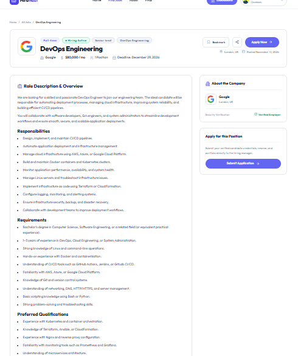

# 🚀 HireNest — Modern AI-Powered Job Portal

HireNest is a production-grade, AI-powered recruitment platform that seamlessly connects ambitious talent with top employers. Featuring Google Gemini AI for smart candidate matching and automated job description generation, HireNest streamlines every phase of the hiring lifecycle — from discovery to application tracking.

## 🔗 Live Demo

- **Live Application:** [https://superio-job-portal-gamma.vercel.app](https://superio-job-portal-gamma.vercel.app)
- **Backend API:** [https://superio-job-portal-backend.onrender.com/api/v1](https://superio-job-portal-backend.onrender.com/api/v1)

## 📸 Screenshots


*HireNest Job Details page featuring comprehensive role specifications, instant application flow, and dynamic category-based similar jobs recommendations.*

## ✨ Key Features

- **Role-Based Portals & Dashboards:** Tailored workspaces and protected routes for Candidates (browse, bookmark, apply, track status), Recruiters (post jobs, manage applicants, candidate matching), and Admins (platform oversight, category management, user moderation).
- **AI-Powered Recruitment (Google Gemini):** One-click AI job description generator for recruiters and intelligent resume-to-job matching score calculation with actionable strength and gap analysis.
- **Secure Dual-Token Auth & Rate Limiting:** JWT-based access and refresh token authentication, role-based authorization guards, multi-tier rate limiting against brute-force attacks, and secure OTP-based password reset.
- **Dynamic Search & Advanced Filtering:** Debounced keyword search, category, job type, experience level, salary range, and location filtering without layout shifts or focus loss.
- **Real-Time Application Tracking:** Cloudinary-backed resume uploads, multi-step application submission, and real-time candidate pipeline statuses (Pending, Shortlisted, Interviewing, Accepted, Rejected).
- **Responsive & Modern UI:** Built with Next.js 16 App Router, React 19, Tailwind CSS, TanStack Query for optimal client caching, and interactive modals.

## 🛠️ Tech Stack

### Frontend Technology Stack

| Technology / Package | Purpose | Version |
|---|---|---|
| `next` | React Framework with App Router, Server Components & Routing | `^16.4.6` |
| `react` | Core UI library for component hierarchy and rendering | `^19.0.0` |
| `react-dom` | React rendering engine for DOM elements | `^19.0.0` |
| `typescript` | Static type checking and enhanced developer tooling | `^5.6.3` |
| `tailwindcss` | Utility-first styling framework (v4 engine) | `^4.0.6` |
| `@tailwindcss/postcss` | PostCSS integration plugin for Tailwind CSS v4 | `^4.0.6` |
| `postcss` | CSS transformation pipeline tool | `^8.4.49` |
| `@tanstack/react-query` | Server state management, data fetching, and intelligent caching | `^5.107.2` |
| `@tanstack/react-query-devtools` | In-browser debugging interface for TanStack Query caches | `^5.107.2` |
| `axios` | Promise-based HTTP client for API request orchestration | `^1.7.7` |
| `lucide-react` | Comprehensive, modern icon set | `^0.460.0` |
| `recharts` | Composable charting library for dashboard analytics | `^3.10.1` |
| `@tiptap/react` | Headless, extensible rich-text WYSIWYG editor | `^3.33.1` |
| `@tiptap/starter-kit` | Essential formatting extensions and Markdown support for Tiptap | `^3.33.1` |
| `@tiptap/extension-link` | Hyperlink handling and parsing extension for Tiptap | `^3.33.1` |
| `@tiptap/extension-placeholder` | Configurable placeholder text support for editor fields | `^3.33.1` |
| `@tiptap/extension-text-align` | Paragraph and heading alignment extension for Tiptap | `^3.33.1` |
| `@tiptap/extension-underline` | Underline text decoration extension for Tiptap | `^3.33.1` |
| `@tiptap/pm` | ProseMirror core packages bundle powering Tiptap | `^3.33.1` |
| `embla-carousel-react` | Lightweight, high-performance carousel / slider | `^8.6.0` |
| `embla-carousel-autoplay` | Automated transition plugin for Embla Carousel | `^8.6.0` |
| `clsx` | Utility for conditionally constructing `className` strings | `^2.1.1` |
| `tailwind-merge` | Utility for merging Tailwind classes without CSS rule conflicts | `^2.5.4` |
| `class-variance-authority` | Type-safe variant-based component styling utility | `^0.7.0` |
| `@types/node` | TypeScript definitions for Node.js runtime APIs | `^22.8.7` |
| `@types/react` | TypeScript definitions for React core | `^19.0.0` |
| `@types/react-dom` | TypeScript definitions for React DOM | `^19.0.0` |

### Backend Technology Stack

| Technology / Package | Purpose | Version |
|---|---|---|
| `express` | Core web application backend framework (v5) | `^5.0.1` |
| `typescript` | Static type checking and modern ECMAScript compilation | `^5.6.3` |
| `@prisma/client` | Type-safe database query builder & ORM client for MongoDB | `^5.22.0` |
| `prisma` | Database schema management and Prisma Client generation CLI | `^5.22.0` |
| `@langchain/google-genai` | Google Gemini AI SDK provider for LangChain | `^2.3.6` |
| `@langchain/core` | Core abstractions for LLM orchestration and structured generation | `^1.4.1` |
| `jsonwebtoken` | Secure JSON Web Token generation and verification | `^9.0.2` |
| `bcryptjs` | Cryptographic password hashing and salt verification | `^2.4.3` |
| `express-rate-limit` | Multi-tier rate limiting for brute-force protection and API abuse defense | `^8.7.4` |
| `zod` | Declarative schema validation for incoming request payloads | `^3.23.8` |
| `cloudinary` | Cloud SDK for candidate resume and company logo storage | `^2.11.0` |
| `multer` | Multipart/form-data middleware for handling file uploads | `^2.5.0` |
| `nodemailer` | SMTP email transport client for verification and password reset codes | `^10.6.0` |
| `sanitize-html` | HTML sanitization for preventing Cross-Site Scripting (XSS) | `^2.18.2` |
| `cookie-parser` | HTTP-only cookie parsing middleware for authentication tokens | `^1.4.7` |
| `cors` | Cross-Origin Resource Sharing middleware | `^2.8.5` |
| `compression` | Response compression middleware (Gzip / Deflate) | `^1.8.2` |
| `dotenv` | Environment variable loader from `.env` files | `^16.4.5` |
| `http-status-codes` | Standardized HTTP status code constants | `^2.3.0` |
| `tsx` | High-performance TypeScript execution and watch tool for development | `^4.19.2` |
| `@types/express` | TypeScript definitions for Express v5 | `^5.0.0` |
| `@types/jsonwebtoken` | TypeScript definitions for jsonwebtoken | `^9.0.7` |
| `@types/bcryptjs` | TypeScript definitions for bcryptjs | `^2.4.6` |
| `@types/multer` | TypeScript definitions for multer | `^2.3.0` |
| `@types/nodemailer` | TypeScript definitions for nodemailer | `^8.0.2` |
| `@types/cors` | TypeScript definitions for cors | `^2.8.17` |
| `@types/cookie-parser` | TypeScript definitions for cookie-parser | `^1.4.7` |
| `@types/compression` | TypeScript definitions for compression | `^1.8.1` |
| `@types/sanitize-html` | TypeScript definitions for sanitize-html | `^2.16.2` |
| `@types/node` | TypeScript definitions for Node.js | `^22.8.7` |

## 🚀 Getting Started

Follow these instructions to set up the project locally on your machine.

### Prerequisites

| Requirement | Version |
|---|---|
| Node.js | 20 or higher |
| Recommended Node.js | 22 |
| Package Manager | npm |

Make sure you also have:
- MongoDB Atlas account or a local MongoDB database instance
- Google Gemini API key *(for AI description generation & candidate matching)*
- Cloudinary account *(for resume and company logo uploads)*

### Environment Variables

#### 1. Backend (`backend/.env`)

Create a `.env` file inside the `backend/` directory and configure the following variables:

```env
PORT=5000
NODE_ENV=development
FRONTEND_URL=http://localhost:3000

# Database
DATABASE_URL="mongodb+srv://<username>:<password>@cluster0.mongodb.net/hirenest?retryWrites=true&w=majority"

# Authentication
JWT_ACCESS_SECRET="your_jwt_access_secret_here"
JWT_REFRESH_SECRET="your_jwt_refresh_secret_here"

# Google Gemini AI
GOOGLE_GEMINI_API_KEY="your_google_gemini_api_key_here"
GEMINI_MODEL="gemini-1.5-flash"

# Cloudinary Storage
CLOUDINARY_CLOUD_NAME="your_cloudinary_cloud_name"
CLOUDINARY_API_KEY="your_cloudinary_api_key"
CLOUDINARY_API_SECRET="your_cloudinary_api_secret"

# Email Service (Nodemailer)
EMAIL_HOST="smtp.gmail.com"
EMAIL_PORT=587
EMAIL_USER="your_email@gmail.com"
EMAIL_PASS="your_gmail_app_password"
```

#### 2. Frontend (`frontend/.env.local`)

Create a `.env.local` file inside the `frontend/` directory:

```env
NEXT_PUBLIC_API_URL=http://localhost:5000/api/v1
```

### Run Locally

1. **Clone the repository:**
```bash
git clone https://github.com/rohanul-haque/superio-job-portal.git
cd superio-job-portal
```

2. **Setup and run the backend:**
```bash
cd backend
npm install
npx prisma generate
npm run dev
```
*Backend runs on `http://localhost:5000` (API endpoint: `http://localhost:5000/api/v1`).*

3. **Setup and run the frontend:**
```bash
cd ../frontend
npm install
npm run dev
```
*Frontend runs on `http://localhost:3000`.*

## 📂 Folder Structure

### Frontend Folder Structure

```text
frontend/
├── public/                       # Static public assets (e.g. logos, icons, screenshots)
├── src/
│   ├── api/                      # Next.js API client definitions
│   ├── app/                      # Next.js 16 App Router pages and layouts
│   │   ├── (public)/             # Public pages (landing, jobs, about, terms, faq)
│   │   │   ├── (auth)/           # Authentication routes (login, register, forgot-password, verify-email)
│   │   │   ├── all-jobs/         # Job listings and search with filter controls
│   │   │   ├── apply-job/[id]/   # Job details and application view
│   │   │   └── page.tsx          # Landing / Homepage
│   │   ├── admin/                # Admin portal
│   │   │   └── dashboard/        # Admin management (jobs, categories, candidates, recruiters, trash)
│   │   ├── candidate/            # Candidate portal
│   │   │   └── dashboard/        # Candidate features (profile, applied jobs, saved jobs, AI recommendations)
│   │   ├── recruiter/            # Recruiter portal
│   │   │   └── dashboard/        # Recruiter features (post job, manage jobs, view applicants, AI matching)
│   │   ├── api/backend/[...slug]/# Next.js server-side reverse proxy route handler
│   │   ├── globals.css           # Global stylesheet and Tailwind CSS v4 directives
│   │   ├── layout.tsx            # Root HTML layout and global context providers
│   │   └── not-found.tsx         # Custom 404 error page
│   ├── components/               # Modular and reusable UI components
│   │   ├── admin/                # Admin management tables, modal dialogs, and moderation tools
│   │   ├── auth/                 # Login, signup, password reset forms, and ProtectedRoute guard
│   │   ├── candidate/            # Candidate profile editors, resume uploaders, and job cards
│   │   ├── dashboard/            # Shared dashboard navigation, headers, and sidebar components
│   │   ├── home/                 # Landing page sections (hero, categories, testimonials, etc.)
│   │   ├── jobs/                 # Job search filters, job cards, details view, and application modal
│   │   ├── loaders/              # Loading skeletons and spinner animations
│   │   ├── recruiter/            # Job post form, Tiptap rich text editor, applicant pipeline table
│   │   ├── shared/               # Shared modals, pagination, empty states, and confirmations
│   │   └── ui/                   # Primitive design system components (buttons, badges, inputs, dialogs)
│   ├── context/                  # React Context providers (AuthContext, CandidateJobStateContext, QueryProvider)
│   ├── hooks/                    # Custom React hooks (useAuth, useJobs, useRecruiter, useToast, etc.)
│   ├── interfaces/               # TypeScript interfaces for API contracts and view models
│   ├── lib/                      # TanStack Query client configuration, query keys, and utilities
│   ├── responses/                # Standardized API response type definitions
│   ├── services/                 # Axios HTTP service layers for backend API consumption
│   ├── types/                    # Shared TypeScript domain types
│   └── proxy.ts                  # Backend reverse proxy configuration
├── .env.example                  # Environment variable template
├── next.config.ts                # Next.js configuration
├── package.json                  # Dependencies and execution scripts
├── postcss.config.mjs            # PostCSS configuration
└── tsconfig.json                 # TypeScript compiler configuration
```

### Backend Folder Structure

```text
backend/
├── prisma/
│   └── schema.prisma             # Prisma ORM schema & MongoDB collection definitions
├── src/
│   ├── config/                   # Centralized application and environment configurations
│   ├── controllers/              # Base controllers (e.g. health-check)
│   ├── lib/                      # Third-party integrations (Cloudinary, Gemini AI, Prisma Client, JWT)
│   ├── middlewares/              # Express middlewares (authGuard, rateLimiters, upload, errorHandler)
│   ├── modules/                  # Feature-based domain modules
│   │   ├── admin/                # Admin analytics, user moderation, trash management, profile
│   │   ├── application/          # Job application processing, candidate applications, status updates
│   │   ├── auth/                 # Candidate & recruiter auth, email verification, password reset, tokens
│   │   ├── bookmark/             # Job saving and bookmarking functionality
│   │   ├── candidate/            # Candidate profile management, resumes, dashboard statistics
│   │   ├── category/             # Job category CRUD operations and icon uploads
│   │   ├── job/                  # Job postings, filters, full-text search, and Gemini AI description generator
│   │   ├── recommendation/       # Gemini AI-powered candidate job recommendations
│   │   └── recruiter/            # Recruiter company profiles, applicant review, AI candidate matching
│   ├── routes/                   # Central API route index and health check routes
│   ├── templates/                # HTML email templates (verification, password reset, status notifications)
│   ├── types/                    # Express ambient type declarations and augmentations
│   ├── utils/                    # Utility helpers (AppError, catchAsync, sanitizeHtml, emailSender, sendResponse)
│   ├── app.ts                    # Express application configuration, middleware pipeline, and route binding
│   └── server.ts                 # Server initialization, database connection, and process lifecycle
├── .env.example                  # Environment variable template
├── package.json                  # Dependencies and execution scripts
└── tsconfig.json                 # TypeScript compiler configuration
```

## 📡 API Reference

Here is the complete documentation of all available Backend API endpoints, organized by feature module.

### 1. System & Health Check

| Method | API Endpoint | Short Description | Authentication Requirement | Required User Role | Request Body / Query Parameters |
|---|---|---|---|---|---|
| `GET` | `/` | API welcome and version index | Public (No Auth) | None | None |
| `GET` | `/health` | Server health check and uptime status | Public (No Auth) | None | None |

### 2. Authentication Module (`/api/v1/auth`)

| Method | API Endpoint | Short Description | Authentication Requirement | Required User Role | Request Body / Query Parameters |
|---|---|---|---|---|---|
| `POST` | `/api/v1/auth/candidate/register` | Register new candidate account | Public (Rate-limited) | None | Body: `{ name, email, password }` |
| `POST` | `/api/v1/auth/recruiter/register` | Register new recruiter account | Public (Rate-limited) | None | Body: `{ name, email, password, companyName }` |
| `POST` | `/api/v1/auth/verify-email` | Verify email address via code | Public (Rate-limited) | None | Body: `{ code, email? }` |
| `POST` | `/api/v1/auth/verify-email/credentials` | Verify email with credentials | Public (Rate-limited) | None | Body: `{ email, password, code }` |
| `POST` | `/api/v1/auth/login` | Authenticate user & issue tokens | Public (Rate-limited) | None | Body: `{ email, password }` |
| `POST` | `/api/v1/auth/refresh-token` | Rotate & reissue access token | Public / Cookie | None | Cookie / Body: `{ refreshToken }` |
| `POST` | `/api/v1/auth/logout` | Invalidate session & clear cookies | Public | None | None |
| `POST` | `/api/v1/auth/resend-verification` | Resend verification email OTP | Public (Rate-limited) | None | Body: `{ email }` |
| `POST` | `/api/v1/auth/forgot-password` | Request password reset OTP email | Public (Rate-limited) | None | Body: `{ email }` |
| `POST` | `/api/v1/auth/reset-password` | Reset password using OTP code | Public (Rate-limited) | None | Body: `{ email, code, newPassword }` |
| `GET` | `/api/v1/auth/me` | Fetch authenticated user profile | Required | `candidate`, `recruiter`, `admin` | None |

### 3. Job Categories Module (`/api/v1/categories`)

| Method | API Endpoint | Short Description | Authentication Requirement | Required User Role | Request Body / Query Parameters |
|---|---|---|---|---|---|
| `GET` | `/api/v1/categories` | Get all active categories with job counts | Public (No Auth) | None | None |
| `GET` | `/api/v1/categories/:id` | Get single category by ID | Public (No Auth) | None | Path Parameter: `id` |
| `POST` | `/api/v1/categories` | Create new job category with icon | Required | `admin` | Multipart Body: `{ name, description?, icon (file) }` |
| `PATCH` | `/api/v1/categories/:id` | Update category details or icon | Required | `admin` | Path Parameter: `id`, Multipart / JSON: `{ name?, description?, icon? (file) }` |
| `DELETE` | `/api/v1/categories/:id` | Soft-delete a job category | Required | `admin` | Path Parameter: `id` |

### 4. Jobs Module (`/api/v1/jobs`)

| Method | API Endpoint | Short Description | Authentication Requirement | Required User Role | Request Body / Query Parameters |
|---|---|---|---|---|---|
| `POST` | `/api/v1/jobs/generate-description` | Generate AI job description with Gemini | Required (Rate-limited) | `recruiter` | Body: `{ title, category, jobType?, experienceLevel?, keySkills?, tone? }` |
| `GET` | `/api/v1/jobs` | Get active jobs with search & filters | Public (No Auth) | None | Query: `page`, `limit`, `searchTerm`, `category`, `jobType`, `experienceLevel`, `location`, `salaryMin`, `salaryMax`, `sort` |
| `GET` | `/api/v1/jobs/my-jobs` | Get jobs posted by logged-in recruiter | Required | `recruiter` | Query: `page`, `limit`, `searchTerm`, `status` |
| `GET` | `/api/v1/jobs/:id` | Get job details and category similar jobs | Public (No Auth) | None | Path Parameter: `id` |
| `POST` | `/api/v1/jobs` | Publish a new job vacancy | Required | `recruiter` | Body: `{ title, categoryId, jobType, experienceLevel, location, salaryMin, salaryMax, description, responsibilities?, requirements?, vacancies, deadline, isVisible? }` |
| `PATCH` | `/api/v1/jobs/:id` | Update job details, visibility or status | Required | `recruiter`, `admin` | Path Parameter: `id`, Body: `{ ...job fields, isVisible?, hiringStatus? }` |
| `DELETE` | `/api/v1/jobs/:id` | Soft-delete a job vacancy | Required | `recruiter`, `admin` | Path Parameter: `id` |

### 5. Candidate Module (`/api/v1/candidate`)

| Method | API Endpoint | Short Description | Authentication Requirement | Required User Role | Request Body / Query Parameters |
|---|---|---|---|---|---|
| `GET` | `/api/v1/candidate/profile` | Fetch candidate profile & resume | Required | `candidate` | None |
| `PATCH` | `/api/v1/candidate/profile` | Update profile, avatar & PDF resume | Required | `candidate` | Multipart Body: `{ title?, bio?, phone?, address?, experience?, skills?, avatar? (file), resume? (file) }` |
| `GET` | `/api/v1/candidate/dashboard-stats` | Fetch candidate metrics & activity chart | Required | `candidate` | None |
| `GET` | `/api/v1/candidate/recommendations` | Fetch AI-matched job recommendations | Required | `candidate` | None |

### 6. Recommendations Module (`/api/v1/recommendations`)

| Method | API Endpoint | Short Description | Authentication Requirement | Required User Role | Request Body / Query Parameters |
|---|---|---|---|---|---|
| `GET` | `/api/v1/recommendations` | Retrieve AI candidate job recommendations | Required | `candidate` | None |

### 7. Recruiter Module (`/api/v1/recruiter`)

| Method | API Endpoint | Short Description | Authentication Requirement | Required User Role | Request Body / Query Parameters |
|---|---|---|---|---|---|
| `GET` | `/api/v1/recruiter/profile` | Fetch company profile & logo | Required | `recruiter` | None |
| `PATCH` | `/api/v1/recruiter/profile` | Update company profile & logo | Required | `recruiter` | Multipart Body: `{ name?, companyName?, companyWebsite?, companySize?, companyLocation?, companyDescription?, logo? (file) }` |
| `GET` | `/api/v1/recruiter/dashboard-stats` | Fetch recruiter metrics & inflow chart | Required | `recruiter` | None |
| `GET` | `/api/v1/recruiter/applicants` | View filterable job applicants | Required | `recruiter` | Query: `page`, `limit`, `jobId`, `status`, `searchTerm` |
| `PATCH` | `/api/v1/recruiter/applicants/:id/status` | Update applicant hiring status | Required | `recruiter` | Path Parameter: `id`, Body: `{ status: "SHORTLISTED" \| "ACCEPTED" \| "REJECTED" }` |
| `GET` | `/api/v1/recruiter/jobs/:jobId/matched-candidates` | AI applicant match scores & analysis | Required | `recruiter` | Path Parameter: `jobId` |

### 8. Applications Module (`/api/v1/applications`)

| Method | API Endpoint | Short Description | Authentication Requirement | Required User Role | Request Body / Query Parameters |
|---|---|---|---|---|---|
| `POST` | `/api/v1/applications/apply` | Apply for a job vacancy | Required | `candidate` | Body: `{ jobId, coverLetter? }` |
| `GET` | `/api/v1/applications/my-applications` | Fetch candidate submitted applications | Required | `candidate` | Query: `page`, `limit` |
| `PATCH` | `/api/v1/applications/:id/withdraw` | Withdraw a pending application | Required | `candidate` | Path Parameter: `id` |

### 9. Bookmarks Module (`/api/v1/bookmarks`)

| Method | API Endpoint | Short Description | Authentication Requirement | Required User Role | Request Body / Query Parameters |
|---|---|---|---|---|---|
| `POST` | `/api/v1/bookmarks/toggle` | Save or unsave a job vacancy | Required | `candidate` | Body: `{ jobId }` |
| `GET` | `/api/v1/bookmarks` | Fetch all saved/bookmarked jobs | Required | `candidate` | Query: `page`, `limit` |
| `DELETE` | `/api/v1/bookmarks/:jobId` | Remove a job from saved list | Required | `candidate` | Path Parameter: `jobId` |

### 10. Admin Module (`/api/v1/admin`)

| Method | API Endpoint | Short Description | Authentication Requirement | Required User Role | Request Body / Query Parameters |
|---|---|---|---|---|---|
| `GET` | `/api/v1/admin/dashboard-stats` | Platform analytics & distribution | Required | `admin` | None |
| `GET` | `/api/v1/admin/candidates` | List candidates with moderation status | Required | `admin` | Query: `page`, `limit`, `searchTerm`, `status` |
| `PATCH` | `/api/v1/admin/candidates/:id/moderate` | Moderate candidate account status | Required | `admin` | Path Parameter: `id`, Body: `{ status, reason? }` |
| `GET` | `/api/v1/admin/recruiters` | List recruiters with moderation status | Required | `admin` | Query: `page`, `limit`, `searchTerm`, `status` |
| `PATCH` | `/api/v1/admin/recruiters/:id/moderate` | Moderate recruiter account status | Required | `admin` | Path Parameter: `id`, Body: `{ status, reason? }` |
| `GET` | `/api/v1/admin/jobs` | Master list of all platform jobs | Required | `admin` | Query: `page`, `limit`, `searchTerm`, `status` |
| `PATCH` | `/api/v1/admin/jobs/:id/moderate` | Moderate job vacancy listing | Required | `admin` | Path Parameter: `id`, Body: `{ isVisible?, hiringStatus?, reason? }` |
| `GET` | `/api/v1/admin/trash` | View soft-deleted platform entities | Required | `admin` | Query: `type`, `page`, `limit` |
| `PATCH` | `/api/v1/admin/trash/restore` | Restore soft-deleted entity | Required | `admin` | Body: `{ type: "JOB" \| "CATEGORY" \| "USER", id }` |
| `DELETE` | `/api/v1/admin/trash/:type/:id` | Permanently delete entity | Required | `admin` | Path Parameters: `type`, `id` |
| `GET` | `/api/v1/admin/profile` | Get admin profile & security status | Required | `admin` | None |
| `PATCH` | `/api/v1/admin/profile` | Update admin name and email | Required | `admin` | Body: `{ name?, email? }` |
| `POST` | `/api/v1/admin/profile/avatar` | Upload admin profile avatar image | Required | `admin` | Multipart Body: `{ avatar (file) }` |
| `PATCH` | `/api/v1/admin/profile/avatar` | Update admin profile avatar image | Required | `admin` | Multipart Body: `{ avatar (file) }` |
| `DELETE` | `/api/v1/admin/profile/avatar` | Remove admin profile avatar image | Required | `admin` | None |
| `DELETE` | `/api/v1/admin/profile/image` | Remove admin avatar image (alias) | Required | `admin` | None |
| `PATCH` | `/api/v1/admin/change-password` | Change admin account password | Required (Rate-limited) | `admin` | Body: `{ currentPassword, newPassword }` |

## 🤝 Contributing

Contributions are what make the open source community such an amazing place to learn, inspire, and create. Any contributions you make are **greatly appreciated**.

1. Fork the Project
2. Create your Feature Branch (`git checkout -b feature/AmazingFeature`)
3. Commit your Changes (`git commit -m 'Add some AmazingFeature'`)
4. Push to the Branch (`git push origin feature/AmazingFeature`)
5. Open a Pull Request

## 📜 License

This project is licensed under the [MIT License](LICENSE). You are free to use, modify, and distribute this code as per the license terms.

## 👤 Author

- **MD Rohanul Haque Rohan**
- Portfolio: [rohanul-haque.me](https://rohanul-haque.me)
- GitHub: [@rohanul-haque](https://github.com/rohanul-haque)
- LinkedIn: [MD Rohanul Haque Rohan](https://www.linkedin.com/in/md-rohanul-haque/)
